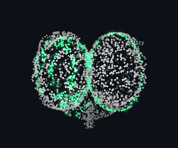
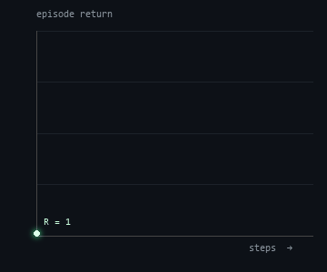

# Hey, I'm Marsel 👋

Machine learning, reinforcement learning & a few side quests.

  

🎓 Master's in machine learning at [**Mila**](https://mila.quebec/)  
🧠 Into reinforcement learning, AI agents, and making data useful.

> *Your life is the recipe. Take ownership.*

[Portfolio](https://marselbakashov.netlify.app/) · [LinkedIn](https://www.linkedin.com/in/marsel-bakashov-813643213/)

---

## 🧰 Tech I use

  
  
  
  
  
  
  
  
  
  
  
  

---

## 🧩 A little problem-solving

---

## 📈 Lately on GitHub

<a href="https://github.com/Mbaka11?tab=overview">
  <picture>
    <source media="(prefers-color-scheme: dark)" srcset="https://github-profile-summary-cards.vercel.app/api/cards/profile-details?username=Mbaka11&amp;theme=github_dark" />
    
  </picture>
</a>

